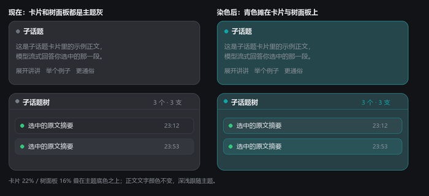
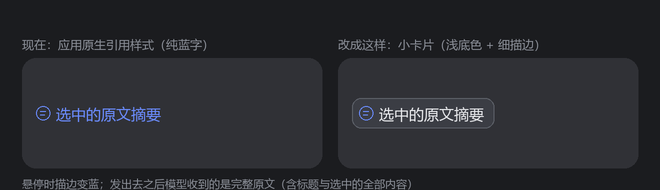

# dsh-subtopic

在 DSH 会话里**选中一段文字 → 按一下 Ctrl（或点出现的胶囊）→ 就地弹出「子话题」卡片**，由当前选中的模型流式解答这一段，并支持在卡片里继续追问。所有子话题会同时沉淀进**右侧的追问树状图**：追问成链（串联），互不相关的并列成支（并联），点树上的任一行即可把对应卡片调回来。树上任意一行的标题还能**拖进聊天输入框**，变成一张只显示短标题的**引用卡片**（我收到的仍是完整原文）；弹出热键与卡片、树面板的颜色都在 **设置 → 子话题** 里改。

```
选中文字  ──selectionchange──▶  ⌨ Ctrl 子话题解答  ──Ctrl 轻点──▶  ┌─ 子话题 ────────┐
                                                                   │ 引用：选中内容     │      ┌ 子话题树 ── 2 个 · 1 支 ┐
                                                                   │ 流式 Markdown 解答 │      │ ▼ 选中的那一句话  │
                                                                   │ [展开][举例][坑]   │      │    · 推理时 KV 不更新 │
                                                                   │ 输入框…            │      │ · 另一个无关子话题    │
                                                                   └──────────────────┘      └───────────────────────┘
```

## 效果



*左：默认（跟随主题）；右：在 **设置 → 子话题** 里选了青色之后，子话题卡片与追问树面板一起染色。*



*左：应用自带的 `@` 引用样式（纯彩色文字）；右：把树行拖进输入框后得到的引用卡片。*

## 安装

三步：**放进 profile → 注册 bundle → 重启 DSH**。完整教程（含 Windows / macOS 差异、校验、卸载）见 **[INSTALL.md](INSTALL.md)**。

不想手动放源码？DSH 认得"安装 spec"，一条命令即可（**记得带 tag**）：

```powershell
dsh plugin --profile desktop add github:<你的账号>/dsh-subtopic#v0.1.0
```

也可以直接对 DSH 说一句"帮我装 `github:<你的账号>/dsh-subtopic#v0.1.0`"，让它自己下载部署；装完重启 DSH。本节下面那套 `link:` 方式是"改源码立刻生效"，适合自己开发。

```powershell
$profile = "$HOME\.dsh\profiles\desktop"                       # 换成你自己的 profile 目录
git clone https://github.com/<你的账号>/dsh-subtopic.git "$profile\.dsh-subtopic-source"
# 再编辑 $profile\package.json：
#   dependencies       里加  "dsh-subtopic": "link:.dsh-subtopic-source"
#   dsh.profile.bundles 里加 "dsh-subtopic"
cd $profile
pnpm install                                                   # 建立 node_modules\dsh-subtopic 链接
# 重启 DSH
```

## 目录结构

```
lib/client.js        浏览器半：选中 → 胶囊 → 卡片 → 追问树 → 引用卡片 → 设置页
lib/host.js          宿主半：/ext/subtopic/* 路由 + llm.stream 调用与 provider 回退
cordis.patch.yml     把本插件 insert 进 profile 的 cordis 树
package.json         包元数据 + dsh.bundle.patch / dsh.client.inject 声明
test/*.mjs           离线自测（零构建、零依赖，纯 Node 跑真实代码）
docs/*.png           效果示意
```

## 用法

| 操作 | 效果 |
| --- | --- |
| 在任意消息里选中一段文字 | 选区右下角出现 `Ctrl 子话题解答` 胶囊 |
| **按一下 Ctrl 后松开**（不按别的键，1.2 秒内） | 在选区旁弹出卡片并开始回答（热键可在 设置 → 子话题 里换，例如 `Alt`、`Ctrl+Shift`、`F2`） |
| 点胶囊 | 同上 |
| 卡片输入框敲字 + Enter | 就同一段内容继续追问（历史问答一起带给模型） |
| `展开讲讲` / `举个例子` / `更通俗` / `有什么坑` | 一键追问 |
| `重答` / `复制` | 重新生成 / 复制答案 |
| `Esc` | 关掉最上面的卡片（没有卡片时清掉胶囊） |
| 拖卡片标题栏 | 移动卡片 |
| 点卡片里的引用块 | 展开/收起选中原文 |
| **在卡片正文里**选中文字再按 Ctrl | 新子话题**挂在这张卡片下面**（串联），卡片顶部出现 `↳ 追问自「…」` |
| 右下角 `树状图 N` / `收起树状图` | 打开/收起追问树面板 |
| 右边缘的 `子话题树` 竖条 | 面板收起时的入口，点一下展开（数字是节点数） |
| 点树上任意一行 | 调回对应的子话题卡片（已有卡片就置顶并闪烁，没有就从记录重建） |
| **把树行的标题拖进聊天输入框** | 插到光标处（没点过输入框时是末尾）一张**引用卡片（chip）**，和你 @ 出来的引用同款；卡片只显示短标题，发出去时模型收到完整原文 |
| 输入框里敲 `@` | 菜单里多一组 `子话题`，可以直接把某条子话题作为引用插进去 |
| 点输入框里的引用卡片 | 调回这张卡片对应的子话题卡片 |
| 树行悬停时的 `⧉` | 拖不动时的退路：把同一段（完整原文）复制到剪贴板，再 `Ctrl+V` |
| 树行上的 `▶` / `▼` | 折叠/展开这一支的追问 |
| 树行悬停时的 `×` | 删掉这一行**及其整支追问**（正在生成的会一并中止） |
| 拖树面板左边缘 | 调整面板宽度（会被记住） |
| 面板标题栏的 `收起 »` | 收起面板（面板整体从窗口按钮下面开始，不会被 `— □ ✕` 盖住） |
| **设置 → 子话题** | 把弹出热键从 Ctrl 换成别的（`Alt`、`Shift`、`⌘`、`Ctrl+Shift`、`F1`–`F12`…），以及换子话题卡片与追问树面板的颜色 |

Ctrl 的判定是「**干净的轻点**」：按下 Ctrl 后若又按了任何其它键（Ctrl+C、Ctrl+V、Ctrl+A…），或者按住超过 1.2 秒，都不会触发，所以不会和复制粘贴打架。改成组合键（例如 `Ctrl+Shift`）后同样是"整套按齐再干净松开"，多按的修饰键会让这次作废。

多张卡片可同时存在，右下角会出现 `子话题 ×N / 全部关闭`。

## 设置（热键 / 卡片与树面板颜色）

设置左侧导航里会多一页 **子话题**（`ctx.slots.register({ name: 'settings.section', id: 'subtopic', order: 90, … })`，排在 `bili 设置`、`侧边卡片` 这些第三方页之前），里面两行：

- **弹出热键**：点右边的按钮进入录制（按钮变成 `按下新键…`），按下新键即可；`Esc` 取消。只接受修饰键（`Ctrl` / `Alt` / `Shift` / `⌘`，可组合）或 `F1`–`F12`——单字母会在打字时误触发，所以直接不受理。非默认值时旁边出现 `恢复默认`。
- **卡片与树面板颜色**：从 9 个色板里挑（第一个是 `自动`，跟随主题），或用右侧色轮自选。它铺在**子话题卡片**与**右侧追问树面板**的底色、描边与连接线上（卡片正文、树行标题的文字颜色不动，深浅自动跟随主题），同时用在**拖进输入框的引用卡片**（底色 + 细描边 + 图标颜色）、状态点、把手与提示里的 `Ctrl` 键帽上；设置页右侧那张预览卡片与两行树行会立刻变成新颜色。实现是一条独立的 `style#dsh-subtopic-accent`，选择器只认我们自己的 `data-composer-chip="subtopic"` 和自己的类名，应用自带的 `@` 引用外观分毫不动。
  - 表面用的是 `background-image:linear-gradient(rgba(色,α), …)` 叠在主题自带底色**之上**，而不是直接覆盖底色：让主题继续决定基础明度，浅色/深色主题下文字对比度都保得住。强度系数（卡片表面 0.22、树面板 0.16、悬停 0.3）都在 `accentCss()` 里，想更浓改这几个数即可。
  - accent 样式表每次写入都会 `appendChild` 重新追加到 `<head>` 末尾——它和基础样式表选择器权重相同，靠"文档里更靠后"取胜；冷启动时它可能先于基础表被写入，重新追加才能保证顺序。

两项都存在 `dsh-subtopic-prefs` 里，只影响本机这个插件。

## 追问树状图

- **串联**：选区落在某张卡片的正文（或它展开的引用块）里时，新子话题的 `parentId` 就是那张卡片；树上表现为缩进 + 连接线。
- **并联**：选区落在会话正文里（不在任何卡片里）时，新子话题是**新的根**，与其它根并列成支。面板标题显示 `N 个 · M 支`。
- **卡片是视图，树才是账本**：每次开卡都会写入一条持久节点（选区、上下文、问答轮次、状态、时间）。`Esc` 或 `全部关闭` 只关卡片，节点留在树上；点树行即可复原卡片（没有答案的节点会提示点「重答」）。
- **不是按会话隔离的**：树是全局的一份（因为卡片渲染在 root 作用域的 `shell.overlay` 覆盖层里，本来就不区分会话业务对象）。上限 `TREE_LIMIT = 80` 个节点，超出时丢最旧的节点，并把它的子节点改挂到它的父节点上，保持树的形状。
- **引用回对话**：树行的标题是原生 HTML5 拖拽源，`dataTransfer` 上同时放两份东西：

  ```
  application/x-dsh-subtopic   {"id":"<节点 id>"}      ← 我们自己的通道，用来认领这次拖拽
  text/plain                   【子话题引用｜<标题>】\n<完整选区原文，最多 1500 字>   ← 兜底
  ```

  鼠标松在输入框上时，插件用应用自己的"插入引用"原语把它变成一张真卡片：

  ```js
  ctx.get('conversation').input.shell(sessionId).addFiles([{
    source: 'subtopic', ref: <节点 id>, label: <短标题>,
    appearance: 'session',            // 借用应用自带的会话引用图标
    clipboardText: '【子话题｜<短标题>】',   // 输入框里那段字（短）
  }], [])
  ```

  `sessionId` 取自 `ctx.get('uiWorkspace').selection.getSnapshot().sessionId`（即当前主会话）。
  这张卡片**只显示短标题**；发送时应用会调我们自己注册的引用源把它展开：

  ```js
  ctx.get('inputTriggers').registerSource({
    trigger: '@', name: 'subtopic',        // 顺带给 @ 菜单加一组「子话题」
    candidates(...) {...}, onPick(...) {...}, openReference(...) {...},
    codec: { clipboardText: (ref) => '【子话题｜…】',
             serialize: (ref) => Promise.resolve('【子话题引用｜<标题>】\n<完整原文>') },
  })
  ```

  `codec.serialize` 的返回值才是模型看到的东西（应用在提交前用它**替换**掉 chip 那段字），所以"输入框里是小卡片、模型收到完整引文"两件事互不冲突。因为 `serialize` 是提交时按 `ref` 去查的，插件另外把最近 40 条引文按节点 id 存在 `dsh-subtopic-quotes` 里：即使这条子话题后来被删/被裁掉，引用也不会卡住发送。

  外观上，应用自带的引用是"纯彩色文字 + 悬停才出现底色"（它的规则是 `.mxScHa_reference{color:var(--dsw-alias-state-business-primary);background:0 0;padding:0 4px}`）。子话题的引用卡片额外带一层自己的样式：`span[data-composer-chip="subtopic"]` —— 浅底色 + 细描边 + 圆角（悬停描边转品牌蓝），多带一个元素名是为了在样式表先后顺序不确定时也能压过应用那条规则；选择器只认 `data-composer-chip="subtopic"`，所以应用自己的 `@` 引用外观分毫不变。

  拿不到编辑器的会话壳（例如页面还没进入会话）时，插件**不拦截**这次拖拽，编辑器按 `text/plain` 插入纯文本——老行为是可用的兜底；壳拒绝插入时则退化为 `shell.paste(完整引文)`。

浏览器里落盘的三把键（都在 `localStorage`）：

| 键 | 内容 |
| --- | --- |
| `dsh-subtopic-tree` | `{ v, nodes:[…] }`，节点表；生成中途被刷新的 loading/streaming 节点会被归一为 done/error |
| `dsh-subtopic-ui` | `{ v, open, width, collapsed, everOpened }`；首次产生子话题时自动展开一次面板，之后完全听用户的 |
| `dsh-subtopic-errors` | 最近 20 条失败记录（`{ at, stage, detail }`），只写失败、永不抛异常；排错第一站 |
| `dsh-subtopic-quotes` | 最近 40 条"引用卡片"的展开文本（按节点 id），供提交时的 `codec.serialize` 兜底 |
| `dsh-subtopic-prefs` | `{ v, hotkey, accent }`；弹出热键与卡片/树面板颜色（设置 → 子话题） |

## 配置

宿主半的插件 config（`cordis.yml` / `cordis.patch.yml` 里该条目的 `config`），全部可选：

| 键 | 类型 | 默认 | 说明 |
| --- | --- | --- | --- |
| `provider` | string | 界面当前选择 | 覆盖 provider |
| `model` | string | 界面当前选择 | 覆盖模型 |
| `reasoningEffort` | string | 界面当前选择 | 覆盖推理档位 |
| `maxTokens` | number | `2000` | 单次回答上限 |
| `system` | string | 内置中文提示词 | 覆盖系统提示词 |

不配置时用 `agentDefaultModel.currentSelection()` 的模型名，并**按顺序尝试一组 provider 路由**：`deepseek-account`（已登录账号，默认桌面部署里真正能出字的路线）→ `agentDefaultModel` 配置的路由（随附配置是 `deepseek-official`）→ 配置里 pin 的 provider 排在最前。

原因：随附的 `agent-default-model` 行写的是 `deepseek-official`，在有账号登录的桌面部署里这条路线没有可用凭据，`llm.stream()` 不会抛错，而是以一个终结的 `finish` 错误块结束——模型"什么都没说"。所以插件会自动换到能用的路线，卡片的模型标签会在换路线时更新成实际使用的那个。

## HTTP 接口

| 方法 | 路径 | 说明 |
| --- | --- | --- |
| `GET` | `/ext/subtopic/info` | `{ ok, hasLlm, provider, model, reasoningEffort, routes[] }`，客户端启动时探测一次 |
| `POST` | `/ext/subtopic/ask` | 请求体 `{ selection, context, turns }`，响应是流式 `text/plain` |
| `GET` | `/ext/subtopic/graph` | 诊断：客户端模块图里有没有 `dsh-subtopic`（需重启进程后才生效，见下） |

流式线格式（故意不做整体编码，以便边到边渲染）：

```
普通文本…                 直接透传的答案片段
NUL {"t":"meta",…} \n     控制帧：meta | error | done
普通文本…
```

`NUL`（`\u0000`）不可能出现在模型输出文本里，所以它是无歧义的帧标记；只有控制帧才需要 JSON 解析。

## 排错

**卡片弹不出来 / 系统里只有宿主半干活**

宿主半和客户端半是两次独立的加载：

1. **宿主半**（`lib/host.js`）：改完**必须重启 DSH 进程**才生效（见下一节）。`plugin_manager` 的 `set_bundle`（`enabled:false` → `true`）确实会销毁并重新应用插件实例（路由会短暂 404 再回来），但 ESM 的模块命名空间已被缓存，重新应用拿到的仍是旧代码——连换入口文件名（换个 URL 去 `import()`）都试过，无效。
2. **客户端半**（`lib/client.js`）：由网页在加载时通过 `/plugins/??dsh-subtopic/client.js&rev=…` 拉取，`rev` 随内容变化。**正在运行的那个页面不会自己长出这个模块——刷新页面（Ctrl+R / F5）才会加载。** 刷新后可用
   `cordis_inspect_query(platform:"client", provider:"Slots", method:"listSubTree", input:{"root":"shell.overlay"})`
   确认 occupants 里出现 `registrant: "dsh-subtopic"`、`id: "dsh-subtopic-layer"`、`order: 40`。

**改了 `lib/host.js` 但行为没变**

实测：只改文件 + `set_bundle` 重启用的是 ESM 缓存里的旧模块（新加的路由仍然 404，旧路由照常 200），因为 profile 的 `hmr` 配置是 `root: []`，没有任何文件监视。**宿主半的代码改动要重启 DSH 进程才生效。**

**`/ext/subtopic/info` 返回 404**

插件没被加载。检查 profile 的 `package.json` 里 `dsh.profile.bundles` 是否含 `dsh-subtopic`，`node_modules\dsh-subtopic` 是否存在，然后跑一次 `set_bundle`。

**接口探测**

本机 HTTPS/HTTP 探测用 Python 最稳（`Invoke-WebRequest` / `curl.exe` 在部分 Windows 环境不可靠）：

```powershell
python -c "import urllib.request;print(urllib.request.urlopen('http://127.0.0.1:19387/ext/subtopic/info',timeout=8).read().decode())"
```

## 离线自测

两半都可以完全离线跑：**不需要构建、不需要依赖、不需要 DSH 在运行**，`node test/*.mjs` 直接驱动 `lib/` 里的真实代码（DOM / React / fetch / `localStorage` / `navigator.clipboard` 全部打桩）：

```powershell
node test/client-smoke.mjs   # 加载 + apply + 槽位注册（1 秒内跑完）
node test/client-flow.mjs    # 完整交互链路（138 项断言）
node test/host-half.mjs      # 宿主半：路由注册 / provider 回退 / 帧协议（36 项断言）
```

默认测的是本仓库的 `lib/`；想测某个已安装的副本，设 `DSH_SUBTOPIC_CLIENT` 指向那份 `client.js` 即可。

`client-flow.mjs` 用打桩的 DOM / React / fetch / `localStorage` / `navigator.clipboard` 驱动**真实代码**，138 项断言覆盖：选区识别与上下文抽取、Ctrl 干净轻点判定、`Ctrl+C` 不误触发、输入法组字期间的 Ctrl 与 `Esc` 一律不响应（`isComposing` / legacy `keyCode 229`）、多按一个修饰键（`Ctrl+Shift` 再松 `Ctrl`）不触发、NUL 帧解析与 meta 帧取 provider/model、Markdown（段落/列表/围栏代码块/粗体/链接）、`Esc` 关闭、以及整棵树的语义——根节点落盘且带答案、**卡片内选区 → 子卡片（`parentId` + 面包屑）**、两个互不相关的选区成为**两个并列的根**、再嵌套一层、面板计数 `N 个 · M 支`、点行重开卡片（带 `focus`）、chip 追问仍属同一节点（`2 轮`）、面板收起/把手往返与 UI 落盘、删整支（含落盘）、空树时面板与把手一起消失；引用通道则把**假的会话壳**接在 `ctx.get('conversation')` 上，断言：拖拽同时给出自定义 MIME 与 `text/plain`、文件/纯文本拖拽不受影响、拖到输入框上才拦截并被高亮、`addFiles` 收到的那张 chip（`source/ref/label/appearance/clipboardText`，且 `label` 是短标题）、拖拽 id 丢失时仍能从 `dataTransfer` 认领、壳拒绝时退化为 `shell.paste(完整引文)`、没有壳时**不拦截**、落点不在输入框时什么都不做、引用源注册（`@`/`subtopic`）、`codec.serialize` 给模型完整原文而 `clipboardText` 保持短、未知节点也能序列化（发送不会死锁）、点 chip 重开卡片、`@` 菜单的候选/过滤/过期条目；设置页则断言注册到 `settings.section`（`id: subtopic`、`order: 90`）、页面渲染出当前热键与 9 个色板（默认 `自动` 选中、默认时不显示「恢复默认」）、预览区同时给出一张卡片与两行树行、点色板后 `dsh-subtopic-prefs` 落盘且生成 `style#dsh-subtopic-accent`（含该色的 `rgba()` 与只作用于 `data-composer-chip="subtopic"` 的选择器、不碰应用的 `.mxScHa_*`）、重渲染后该色板变 `is-on`、重复点色只复用一个 `<style>`、这张表还染到卡片与树面板表面（`.dsh-subtopic-card`/`.dsh-subtopic-tree` 的 `background-image`、把手与选中行）且始终是 `<head>` 里的最后一个 `<style>`，热重载重跑一次样式 effect 后也仍然最后、且不会多出一张重复的样式表。

`host-half.mjs` 直接 `import` 真实的 `lib/host.js`（含缓存绕过的动态 import），用假 `ctx`（含假 `llm`，按文档契约用终结 `finish` 错误块表示失败）跑 `apply()`，再像 web server 一样驱动被注册的 handler；36 项断言覆盖：三个路由注册、`info.routes` 顺序、首选路线单次调用即出字、首选失败后回退到 `agentDefaultModel` 路线且答案照常流式、全部失败时错误帧带 provider 原文+code+HTTP 状态、配置 pin 的 provider 排最前、空选区在调用模型前就 400。

`localStorage` 是客户端半唯一的"远端副作用"（节点表 + 面板状态），所以打桩它就能把持久化也一起断言掉，而不必去读浏览器的 leveldb。

**沙箱必须与真实契约一致**：早期 `client-smoke.mjs` 在 vm 里补了全局 `module`/`exports`，正好掩盖了"页面里没有 CommonJS 的 `module`"这个真实缺陷（见下）。现在沙箱明确不提供这两个全局。

## 排错：模型"什么都没说"

`llm.stream()` **不抛错**，adapter 选择/派发/迭代失败都以终结的 `finish` 块（`{kind:'error'|'aborted', failure:{message,code,status}}`）返回。所以"卡片转一下就报『模型没有返回任何内容』"几乎总是路由问题，而不是提示词问题：错误帧里现在会带上 provider 原文、`[code]` 和 `(HTTP status)`，以及尝试过的路线列表。

## 卸载

```powershell
$profile = "$HOME\.dsh\profiles\desktop"      # 换成你自己的 profile 目录
Remove-Item -Recurse -Force "$profile\node_modules\dsh-subtopic"      # 链接
Remove-Item -Recurse -Force "$profile\.dsh-subtopic-source"           # 源码
# 再从 $profile\package.json 的 dependencies 与 dsh.profile.bundles 里删掉 dsh-subtopic，重启 DSH
```

`localStorage` 里的三份数据（`dsh-subtopic-tree` / `dsh-subtopic-ui` / `dsh-subtopic-prefs`）跟着页面域走，卸载插件时不会自动清；在开发者工具里删掉它们即可。

## 设计取舍

- **零 import**：宿主半与客户端半都不 import 任何 `@deepseek-ai/*` 包，只依赖 `ctx.get()` 与 loader 注入的 `require('react')`。这样 `link:` 安装不会被 peer 依赖解析拖累（该 profile 是 `nodeLinker: hoisted` + `autoInstallPeers: false`），插件目录里没有 `node_modules` 也能跑。
- **无状态单条消息**：卡片多轮问答不是真的多轮对话，而是把「选中内容 + 上下文 + 已有问答 + 当前问题」压平成**一条** user 消息。因为 `RequestMessage` 的 assistant 分支要求完整的 `ModelMessageSource`，构造成本高而收益为零，卡片答案又短，token 代价可以忽略。
- **自制极简 Markdown**：不引入 marked 之类依赖，`inline()` / `markdown()` 只覆盖模型实际会用的语法（围栏代码块、标题、列表、引用、行内代码、粗体、斜体、链接）。
- **上下文抽取不依赖 DOM 类名**：从选区共同祖先向上最多 9 层，取第一个「明显比选区大且体量适中」的 `innerText`，所以 DSH 前端改版也不会失效。
- **树面板自绘在 `shell.overlay`，没有占用原生右栏 tab**：原生右栏 tab 的 key 是 `tab.kind`，由宿主派发；已装插件（`dsh-better-sidebar`、`@nanmicoder/dsh-agent-teams`）的做法是把宿主**已经创建**的 tab 种类镜像进自己的 store，插件无法凭空注册一种新 tab，而客户端 `layout` 服务只有 `selectPanel/beginNavigation/toggleSidebar/openRightbar/closeRightbar`。所以面板做成覆盖层里贴右边缘的 fixed 停靠面板（`z-index: 9001`，卡片是 9000 上下）：零新契约、不新增 `inject`、改客户端半不必重启 app。代价是不与原生右栏共享几何与推挤行为。
- **只有两处 DOM 依赖**：追问关系靠 `closest('.dsh-subtopic-body, .dsh-subtopic-quote')` 判断"选区是否落在某张卡片里"，拖放靠 `closest('[data-composer-input]')`（含"向上找含它的祖先"兜底）判断"有没有落在输入框上"。前者是我们自己渲染的类名；后者是应用输入框自己的属性，且**认不出来时就完全不拦截**，最坏情况退化成普通文本拖放。
- **面板必须避开窗口按钮那 40px**：桌面壳用 `titleBarStyle:'hidden'` + `titleBarOverlay:{height:40}`（在 `resources/app.asar` 里创建 `BrowserWindow` 的那段代码），也就是最小化/最大化/关闭由系统画在内容区**顶部 40px 的右上角，且永远在网页之上**——面板原来是 `top:0`，标题栏连同 `收起 »` 正好被盖住（点了没反应、也看不见）。现在面板是 `top:env(titlebar-area-height,40px)`，卡片的落点与胶囊的 Y 也都抬到 `TOP_SAFE = 40` 以下。
- **引用走"应用自己的引用卡片"，而不是把文字倒进输入框**：树行同时写自定义 MIME（认领这次拖拽）与 `text/plain`（兜底）。落到输入框上时调应用自己的插入原语 `conversation.input.shell(sessionId).addFiles([{source,ref,label,appearance,clipboardText}], [])` 生成真 chip，并注册一个 `inputTriggers` 引用源（`trigger:'@'`, `name:'subtopic'`）——应用提交前会用 `codec.serialize(ref)` 把 chip 那段字**替换**成完整引文，所以"输入框里是小卡片、模型收到完整原文"可以同时成立。自定义 MIME 而不是强改 `text/plain`，是因为文件/纯文本拖拽在应用里另有监听（只认 `types.includes('Files')`），用独立类型才能既认领自己的拖拽又不影响别人。拿不到会话壳时不拦截、壳拒绝时退化为 `shell.paste(...)`，所以这套机制失效时仍然是"能用"的老行为。
- **设置项占一整页（`settings.section`）而不是往通用设置里塞一行**（`settings.general.item`）：热键录制需要一个"按下新键"的交互态与提示文案，色板也需要一整行，塞进通用设置的一行控件里会很挤；独立页还能顺便放一段说明和一张引用卡片预览（预览直接复用 `data-composer-chip="subtopic"` 的样式，所见即所得）。注册的 `order: 90` 让它排在第三方页（`bili 设置`、`侧边卡片` 都是 100）之前。代价：`settings.section` 的注册契约只投影 `id`/`order`/`label`，**图标拿不到**，所有外部设置页在导航里都是同一个齿轮（这是 DSH 0.1.x 已知限制，`dsh-better-sidebar` 是靠事后给自己那行 nav 打 DOM 标记画的图标；我们不做这件事，免得跟宿主 UI 打架）。
- **热键只收修饰键与 F 键**：`normalizeHotkey()` 把组合归一成 `Ctrl+Shift` 这类规范形式，**单字母一律拒绝**（否则 `s`、`c` 这种键在输入框打字时就会弹卡片）。触发器仍保持"干净轻点"语义：多按了不在组合里的键（stray）或多按了普通键（extra）都会让这次作废，因此 `Ctrl+Shift` 模式按着 Ctrl 再敲 `s` 不会误触。**组字期间一律让路**（`isComposing` 或 `keyCode 229`）：候选窗开着时按键属于输入法，热键与 `Esc` 都不响应——这与 DSH 内核的 IME 守卫（issue #535）以及 `dsh-better-sidebar` 在文档 capture 阶段做的同一守卫是同一套约定，否则会出现"有时该弹、有时不弹"的分裂行为。
- **配色只写一条自己的 `<style>`**：改动只影响 `span[data-composer-chip="subtopic"]`、`.dsh-subtopic-card/-dot/-pill/-kbd`，用元素名把权重抬到 (0,1,1) 压过应用那条 `.mxScHa_reference`，与两张表的先后顺序无关；应用自带的 `@` 引用外观一点不变。
